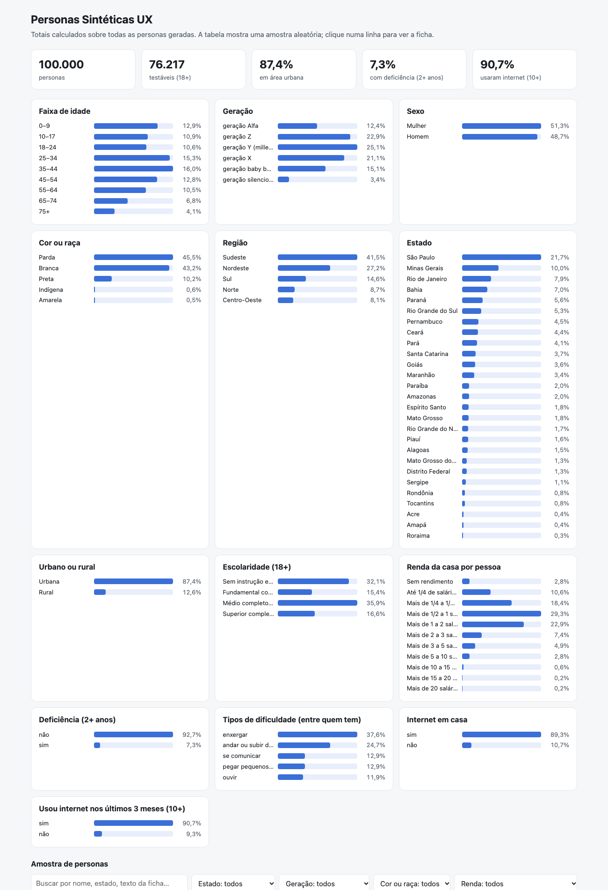

# Personas Sintéticas UX

**O Brasil inteiro cabe numa sala de teste.** 100 mil pessoas sintéticas, com a cara do país, prontas para testar o seu produto antes de ele chegar a quem importa.

Criado por **[Elvis Soares](https://elvis.work/)**.

Personas Sintéticas UX é uma base aberta de personas que **retratam a população brasileira** e um caminho para usá-las em testes de usabilidade com agentes de IA. Cada persona é uma pessoa fictícia sorteada a partir de dados públicos do IBGE: idade, sexo, cor ou raça, estado, escolaridade, renda, deficiência, uso de internet, orientação sexual e identidade de gênero aparecem na mesma proporção do país (ver [docs/validacao-v0.md](docs/validacao-v0.md)).

> Personas sintéticas **não substituem** pesquisa com pessoas reais, em especial com pessoas com deficiência. Use como triagem e para ampliar repertório, não como prova.

## De onde vem: o MatrAIx

Este projeto se apoia no **[MatrAIx](https://github.com/MatrAIx-ai/MatrAIx)**, a plataforma aberta (MIT) que simula o mundo com agentes-persona e os coloca para responder pesquisas, conversar com chatbots, navegar em sites e usar apps. Todo o crédito pela plataforma é da equipe do MatrAIx:

> Li, X., Hao, Y., Hou, J., Huang, J., Wen, Q., Huang, S., Liu, Y., Liu, X., Fan, Y., Wang, Y., Wu, K. et al. **MatrAIx: Simulating the World with 8.3 Billion Persona Agents.** arXiv:2608.04205, 2026. [matraix.ai](https://matraix.ai)

O MatrAIx foi feito para pesquisa em larga escala. **Personas Sintéticas UX** é a versão pensada para o dia a dia de quem desenha produtos, com duas contribuições:

1. **Uma base brasileira de verdade** (pronta, nesta versão): 100 mil personas calibradas com o Censo 2022, a PNAD TIC 2025 e a PNS 2019, todas com fonte e status de cada campo.
2. **[MatrAIx UX](https://github.com/elvisoares42/matraix-ux)**, um fork do MatrAIx otimizado para testes de UX, para a persona fazer o que um participante faz numa sessão de usabilidade:

| O que a persona faz | Status |
|---|---|
| **Navega no navegador de verdade**, tocando, rolando e digitando no seu protótipo ou site, só no que está visível e sem dicas | ✅ pronto |
| **Pensa em voz alta**: narra o que lê, o que espera, o que estranha e por que desistiu, como num teste moderado | ✅ pronto |
| **Gravação de vídeo e áudio** da sessão, com a voz da persona, legenda e corte dos trechos parados | ✅ pronto |
| **Usa o celular do jeito do seu perfil**: quem só usa celular, quem tem pouca familiaridade, quem tem dificuldade para enxergar | ✅ pronto |
| **Encontra problemas reais** na interface e diz onde estão, com gravidade; SEQ adaptada em cada etapa | ✅ pronto |
| **Formulário em escala**: SUS, NPS e perguntas abertas para centenas de personas | ✅ pronto |

O passo a passo, o custo médio por teste (usabilidade com 5 personas e vídeo: ~US$ 2,20 com voz básica ou ~US$ 4,50 com voz melhorada; formulário com 400 personas: ~US$ 0,40) e prompts prontos para Claude Code, GitHub Copilot, Cursor e Codex estão no [guia do fork](https://github.com/elvisoares42/matraix-ux/blob/main/docs/ux/COMO-USAR.md).
A base também funciona com o MatrAIx original e com qualquer agente de IA: cada persona traz uma **ficha em texto** para usar como instrução.

## Onde baixar

- **Hugging Face**: a base pronta (Parquet e JSONL, com o cartão do dataset) vai ficar no Hugging Face, para baixar sem precisar rodar nada. `scripts/preparar_hf.py` monta a pasta de publicação.
- **Aqui**: gere com os comandos de "Como gerar" abaixo; o resultado é sempre o mesmo (gerador determinístico).



Para explorar no navegador: `python3 scripts/explorar.py` gera `saida/explorar.html` com os totais e uma amostra navegável com filtros e a ficha de cada persona.

## O que tem na v0

- **100 mil personas** da população toda (todas as idades), em PT-BR.
- Só maiores de 18 anos são marcados como `testavel = sim`; crianças e adolescentes entram para o retrato estatístico.
- Gerador **determinístico**: a persona nº N é sempre a mesma, gere-se mil ou 100 mil. Dá para gerar mais com o mesmo script.
- Para cada persona: os campos abaixo e uma **ficha em texto** pronta para dar a um agente de IA.

| Campo | Status | Fonte |
|---|---|---|
| UF, região, cor ou raça, sexo, idade | ✅ | Censo 2022, tabela 9606 (sorteio conjunto) |
| Ano de nascimento e geração | ✅ | calculado (silenciosa, boomer, X, Y, Z, Alfa) |
| Pessoa negra | ✅ | preta ou parda (critério do IBGE e do Estatuto da Igualdade Racial) |
| Quilombola | ✅ | Censo 2022, tabela 10089 (por UF, sexo e idade) |
| Orientação sexual (18+) | ✅ / ⚠️ | IBGE, PNS 2019 (estatística experimental): heterossexual, homossexual, bissexual, outra, não sabe, prefere não responder; varia por idade, sexo, UF e urbano/rural |
| Identidade de gênero (18+) | ⚠️ | não há dado oficial; estudo nacional de Spizzirri et al. (Scientific Reports, 2021): 0,69% pessoas trans e 1,19% não binárias |
| Nome | ✅ / ⚠️ | IBGE Nomes (Censo 2010), ranking por estado, década e sexo; peso pela raiz da frequência (o ranking só traz o top 20) e, fora de 1930–2010, a década mais próxima |
| Sobrenome | ⚠️ | lista de sobrenomes comuns (não há tabela oficial) |
| Urbano ou rural | ✅ | Censo 2022, tabela 10089 |
| Escolaridade (18+) | ✅ | Censo 2022, tabela 10061 |
| Renda domiciliar per capita | ✅ / ⚠️ | Censo 2022, tabela 10296 (por UF, sexo e cor ou raça; sem ligação com idade e escolaridade) |
| Deficiência e tipos de dificuldade | ✅ / ⚠️ | Censo 2022, tabelas 10125 e 10127 (combinação de tipos sorteada de forma independente) |
| Internet em casa | ✅ | Censo 2022, tabela 9942 |
| Usou internet nos últimos 3 meses (10+) e só pelo celular | ✅ / ⚠️ | PNAD Contínua TIC 2025, tabelas 7334 e 7337 (independente da internet em casa) |

O detalhe de cada campo fica em `saida/campos.json`.

## Como gerar

Só Python 3.9+ (biblioteca padrão).

```bash
python3 scripts/baixar_fontes.py
python3 scripts/gerar.py 100000
python3 scripts/validar.py
scripts/checar_termos.sh
```

- `baixar_fontes.py`: baixa as tabelas do SIDRA/IBGE e da API IBGE Nomes para `dados/fontes/`.
- `gerar.py`: grava `saida/personas.csv`, `saida/personas.jsonl` (com a ficha) e `saida/campos.json`.
- `validar.py`: compara a amostra com o IBGE e grava `docs/validacao-v0.md`.
- `explorar.py`: gera `saida/explorar.html` para ver as personas no navegador.
- `preparar_hf.py`: monta `saida/hf/` (Parquet, JSONL e cartão do dataset) para o Hugging Face; precisa do pyarrow.
- `checar_termos.sh`: barra a publicação se aparecer algum termo da lista local `.termos-proibidos` (fora do git).

## Limitações da v0

- **Retrato de 2022**: idades e campos do Censo 2022 (a ficha diz "no Censo de 2022 tinha N anos" e o ano de nascimento); o uso de internet é da PNAD 2025.
- **Ligações entre campos**: o sorteio é conjunto só em UF × cor ou raça × sexo × idade. Os outros campos dependem dessas quatro variáveis, mas não uns dos outros (ex.: renda não depende da escolaridade; uso de internet não depende da renda). Isso suaviza correlações reais.
- **Universo**: renda e internet em casa vêm de moradores de domicílios particulares permanentes; aplicamos à população toda.
- **Nomes**: o ranking do IBGE traz só os 20 nomes mais comuns por estado, década e sexo; nomes raros não aparecem.
- **Sexo**: o Censo 2022 só perguntou sexo (homem ou mulher), sem identidade de gênero nem orientação. Por isso são três campos: sexo (Censo), identidade de gênero (estudo acadêmico ⚠️) e orientação sexual (PNS 2019). Pessoas intersexo não estão representadas: não há estimativa nacional confiável.
- **Orientação sexual**: a PNS 2019 é a primeira medição oficial e o próprio IBGE a considera experimental e provavelmente subnotificada (2,3% preferiram não responder). Pesquisas independentes chegam a números bem maiores (ex.: 12% de adultos LGBT+ e assexuais em Spizzirri et al., 2022; 9,3% LGBT+ no Datafolha de 2022): a comparação está no fim de [docs/validacao-v0.md](docs/validacao-v0.md).

  > **Nota de Elvis Soares:** acredito que o número real é maior do que o do IBGE e considero o dado desatualizado. Pesquisei em outras fontes e em grupos representativos, mas não encontrei um dado que represente a população de forma confiável. Por isso, mantive o dado do IBGE, por falta de fonte melhor.
- **Identidade de gênero**: sorteio com a mesma chance em todo o país e em todas as idades (o estudo não achou diferença entre regiões; pessoas trans eram mais jovens, efeito ainda não aplicado).
- **Cor ou raça**: as 5 categorias de autodeclaração do IBGE. Quilombola é sorteado à parte (sem ligação com cor ou raça) e pessoas indígenas que se declararam de outra cor (contadas pelo Censo na pergunta "se considera indígena") ainda não entram.
- Não há jornadas (transporte, saúde, alimentação, finanças, telecom, moradia), fatores políticos nem renda individual. Ficam para as próximas versões.

## Próximas versões

1. **Jornadas**: serviços usados e dores típicas por segmento, a partir de dados abertos (Consumidor.gov.br, Banco Central, ANS, Anatel) e do feed público de avaliações da App Store, só agregados e com tratamento igual para todas as empresas.
2. **Squad de especialistas**: avaliadores de produto, UX, UI, desenvolvimento, acessibilidade, marketing, UX writing e privacidade, com ferramentas como axe e Lighthouse.
3. **Mais tarefas de exemplo no [MatrAIx UX](https://github.com/elvisoares42/matraix-ux)**: app de banco, agendamento de saúde, cadastro em serviço público.

## Licenças (propostas)

- Código: MIT.
- Base de personas: CC BY 4.0.
- Dados de origem: IBGE (uso livre com citação da fonte).

## Créditos

- Base, gerador e fork UX: **[Elvis Soares](https://elvis.work/)**.
- Plataforma de agentes-persona: [MatrAIx](https://github.com/MatrAIx-ai/MatrAIx) (Li, X. et al., arXiv:2608.04205, 2026), licença MIT.
- Dados: IBGE (Censo 2022, PNAD Contínua TIC 2025, PNS 2019); identidade de gênero: Spizzirri et al., *Scientific Reports*, 2021.

## Decisões

Ver [DECISOES.md](DECISOES.md).
